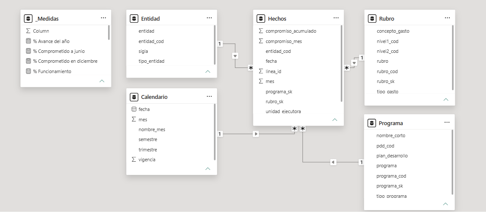

# Gestión y análisis de compromisos presupuestales de Bogotá D. C. (2022–2025)

**Proyecto final — Herramientas de Gestión de Datos**

Autores: Angie Coba, Luis Florez, Jhon Fonseca (Equipo 7)

## 1. Descripción del proyecto

Este proyecto desarrolla una solución de gestión y análisis de datos para estudiar los compromisos presupuestales de entidades distritales de Bogotá D. C. durante el periodo 2022–2025.

La solución integra fuentes de datos presupuestales, un modelo de datos relacional y dimensional, procesos reproducibles de auditoría y transformación con Python, y un tablero de inteligencia de negocios desarrollado en Power BI.

Su propósito es facilitar la exploración de la información presupuestal por vigencia, entidad, unidad ejecutora, programa y rubro, y demostrar cómo el modelamiento, la calidad de datos y la inteligencia de negocios contribuyen a convertir registros administrativos en información útil para el análisis y la toma de decisiones.

## 2. Objetivos

**Objetivo general**

Diseñar y documentar una solución de gestión de datos que permita organizar, validar y analizar los compromisos presupuestales de Bogotá D. C. para las vigencias 2022–2025, aplicando principios de modelamiento de datos, inteligencia de negocios y calidad de información.

**Objetivos específicos**

1. Estructurar los datos presupuestales mediante un modelo relacional y dimensional que facilite su consulta y análisis.
2. Implementar procedimientos reproducibles de lectura, normalización, validación y transformación de información presupuestal.
3. Facilitar el análisis histórico mediante una tabla de hechos y un dashboard de Power BI.
4. Identificar limitaciones y oportunidades de mejora relacionadas con la completitud, unicidad, consistencia y trazabilidad de los datos.

## 3. Fuente y alcance

El proyecto utiliza información del conjunto de datos **Informe de Gastos e Inversiones de Bogotá D. C.**, publicado en el portal de Datos Abiertos de Bogotá y asociado a información del sistema BogData.

Fuente de referencia: https://datosabiertos.bogota.gov.co/dataset/informe-de-gastos-e-inversiones-bogota

La tabla de hechos utilizada para el análisis histórico comprende cuatro vigencias:

| Vigencia | Registros |
|---|---:|
| 2022 | 132.372 |
| 2023 | 125.196 |
| 2024 | 165.228 |
| 2025 | 92.172 |
| **Total** | **514.968** |

La cobertura de la tabla de hechos incluye 44 códigos de entidad, 95 unidades ejecutoras, 1.308 identificadores de programa y 3.098 identificadores de rubro.

Estas cantidades describen la estructura del conjunto de datos y no representan, por sí mismas, montos de ejecución presupuestal.

## 4. Áreas de conocimiento aplicadas

### 4.1. Modelamiento de datos

Se elaboró un archivo SQL que propone dos capas:

- **Capa normalizada (`presupuesto`):** contempla entidades, unidades ejecutoras, periodos, planes de desarrollo, programas, tipos de gasto, conceptos, rubros y compromisos mensuales.
- **Capa analítica (`dw`):** propone un esquema estrella con dimensiones de entidad, programa, rubro y calendario, relacionadas con una tabla central de compromisos.

El modelo busca organizar las relaciones entre las variables presupuestales y facilitar consultas analíticas.

### 4.2. Inteligencia de negocios

Se dispone de una tabla de hechos histórica denominada `Hechos_Compromisos.csv` y de un dashboard desarrollado en Power BI.

La tabla de hechos contiene las siguientes variables:

`vigencia`, `mes`, `fecha`, `entidad_cod`, `unidad_ejecutora`, `programa_sk`, `rubro_sk`, `linea_id`, `compromiso_acumulado` y `compromiso_mes`.

Esta estructura permite organizar el análisis por tiempo y por dimensiones institucionales y presupuestales, mediante las relaciones configuradas en el modelo BI.

El archivo `.pbix` se encuentra en la carpeta `dashboard/`.

### Modelo dimensional implementado en Power BI

El modelo analítico se organiza mediante un esquema estrella, con una tabla central de hechos (`Hechos`) y cuatro dimensiones: `Entidad`, `Rubro`, `Programa` y `Calendario`. Las relaciones uno a muchos permiten analizar los compromisos presupuestales desde diferentes perspectivas institucionales, temporales y presupuestales.

Adicionalmente, la tabla `_Medidas` centraliza los indicadores calculados mediante DAX, favoreciendo la reutilización de medidas y la consistencia de las visualizaciones.

### Dashboard de inteligencia de negocios

El dashboard permite explorar los compromisos presupuestales de Bogotá D. C. durante 2022–2025, utilizando filtros por vigencia, tipo de gasto, tipo de entidad y entidad.

La solución presenta indicadores de compromisos acumulados, variación anual, participación de inversión y concentración del gasto, además de visualizaciones sobre composición presupuestal, evolución mensual, entidades y conceptos de gasto.

**Ejemplo de lectura — vigencia 2025:** el tablero presenta compromisos aproximados de $36,3 billones, una variación anual del 14,2 %, participación de inversión del 82,0 % y concentración del 69,5 % en las cinco principales entidades, según las medidas y filtros configurados en Power BI.

### 4.3. Calidad y transformación de datos

Se desarrolló el notebook `notebooks/01_auditoria_eda.ipynb`, enfocado en el archivo presupuestal con corte a diciembre de 2025.

El proceso comprende:

- Lectura del CSV con codificación `cp1252`.
- Normalización de encabezados y campos descriptivos.
- Exclusión de una fila informativa que no corresponde a un registro presupuestal.
- Identificación de celdas vacías y valores representados mediante guiones.
- Verificación de unicidad de la clave de negocio.
- Conversión controlada de valores monetarios.
- Análisis de variaciones entre compromisos acumulados consecutivos.
- Exportación de archivos procesados y reportes de calidad.
- Validaciones de integridad entre las tablas transformadas.

## 5. Resultados de calidad de datos: vigencia 2025

La auditoría del archivo original produjo los siguientes resultados:

| Indicador | Resultado |
|---|---:|
| Filas leídas inicialmente | 7.682 |
| Filas informativas excluidas | 1 |
| Registros presupuestales válidos | 7.681 |
| Columnas | 18 |
| Entidades distintas | 44 |
| Rubros distintos | 2.198 |
| Duplicados exactos | 0 |
| Duplicados con clave original | 128 |
| Duplicados con clave ampliada | 0 |
| Registros con alguna disminución mensual | 669 |
| Eventos de disminución mensual | 838 |

La clave original `vigencia + codigo_entidad + codigo_rubro` no permitía identificar de manera única todos los registros.

La clave ampliada `vigencia + codigo_entidad + nombre_de_la_entidad + codigo_rubro` eliminó las duplicaciones detectadas en el archivo analizado. La revisión mostró que diferentes unidades ejecutoras podían compartir el mismo código institucional y rubro.

En cuanto a completitud, los registros sin valor numérico representaron el 76,37 % en enero y el 19,05 % en diciembre. Los valores no numéricos identificados correspondieron a celdas vacías y guiones, sin encontrar otros símbolos no convertibles.

Se identificaron 669 registros con al menos una disminución entre meses consecutivos. Estos casos se conservaron como alertas analíticas, sin clasificarlos automáticamente como errores presupuestales.

## 6. Transformación y validación

El proceso ETL generó:

| Archivo | Finalidad |
|---|---|
| `compromisos_2025_limpio.csv` | Registros normalizados y valores monetarios convertidos |
| `compromisos_2025_mensual.csv` | Estructura mensual en formato largo |
| `reporte_calidad_2025.csv` | Indicadores de completitud y validez |
| `reporte_variaciones_2025.csv` | Variaciones y disminuciones mensuales |

Se verificó que la transformación conservara los 7.681 registros presupuestales y produjera 92.172 filas mensuales, equivalentes a doce meses por registro.

También se comprobó que el total de compromisos acumulados de diciembre coincidiera entre los formatos ancho y largo: **$36.256.796.365.772 COP**. Este resultado corresponde a la suma calculada sobre el archivo auditado y requiere contrastarse con los totales oficiales antes de utilizarse como cifra presupuestal consolidada.

## 7. Reflexión sobre la gestión de datos

El proyecto evidencia que la utilidad de un dashboard depende de decisiones previas sobre la estructura, interpretación y calidad de los datos.

La revisión de claves permitió identificar que una entidad puede tener varias unidades ejecutoras, lo cual influye directamente en la granularidad del modelo y en la confiabilidad de las agregaciones.

Asimismo, el tratamiento diferenciado de valores vacíos, guiones y disminuciones evitó introducir supuestos no verificados en la información presupuestal.

La integración de modelamiento, auditoría y visualización constituye una base para fortalecer la trazabilidad, la transparencia y el análisis de información pública.

## 8. Matriz de cumplimiento de la evaluación

| Criterio | Evidencia |
|---|---|
| Contexto y propósito del conjunto de datos | Secciones 1, 2 y 3 |
| Origen y cobertura de la información | Sección 3 y carpeta `datos/originales/` |
| Descripción de variables y volumen | Secciones 3 y 4 |
| Modelamiento de datos | Archivo `sql/modelo_fisico_presupuesto_postgresql.sql` |
| Inteligencia de negocios | Carpeta `dashboard/` y tabla `Hechos_Compromisos.csv` |
| Calidad y transformación | Notebook `notebooks/01_auditoria_eda.ipynb` |
| Evidencias de resultados | Secciones 5 y 6; archivos en `datos/procesados/` |
| Reflexión | Seccion 7  |

## 9. Reproducibilidad

Para reproducir la auditoría de 2025:

1. Clonar el repositorio.
2. Instalar Python y las dependencias indicadas en `requirements.txt`.
3. Abrir `notebooks/01_auditoria_eda.ipynb` en Visual Studio Code con la extensión Jupyter.
4. Seleccionar el kernel de Python.
5. Ejecutar las celdas en orden.
6. Consultar los archivos generados en `datos/procesados/`.

Para explorar la solución de inteligencia de negocios, abrir el archivo `.pbix` con Power BI Desktop. La actualización del modelo puede requerir configurar nuevamente las rutas de los archivos de origen.