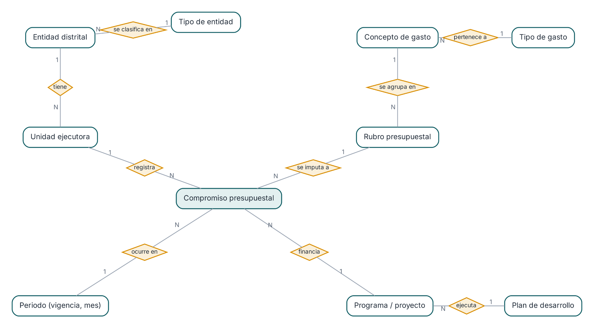
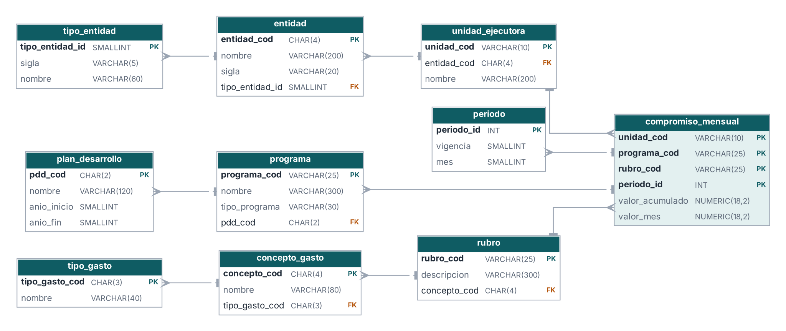
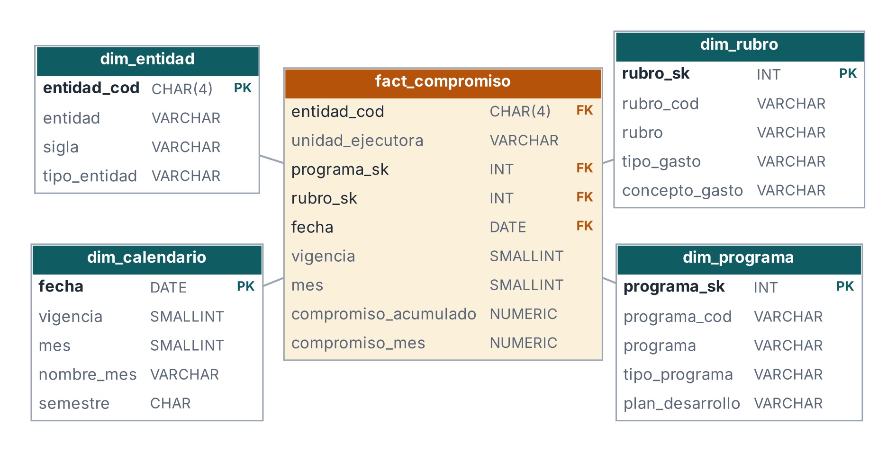
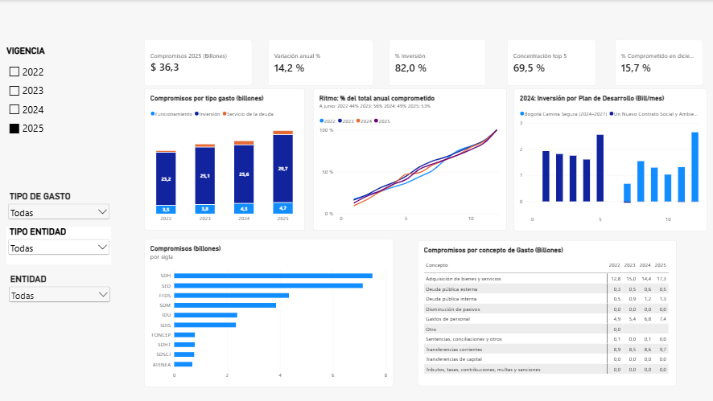

# Gestión y análisis de compromisos presupuestales de Bogotá D. C. (2022–2025)

**Proyecto final — Herramientas de Gestión de Datos**  
**Equipo 7:** Angie Coba, Luis Flórez y Jhon Fonseca.

## 1. Problema, contexto y propósito

¿Cómo se distribuyen los compromisos presupuestales del Distrito, cómo cambian entre 2022 y 2025 y a qué ritmo se registran durante cada vigencia? El proyecto organiza datos públicos de la Secretaría Distrital de Hacienda de Bogotá para comparar entidades, tipos de gasto, rubros, programas y períodos mediante un modelo de datos y visualizaciones.

**Objetivo general:** transformar datos presupuestales publicados en información estructurada y consultable para apoyar el seguimiento, la transparencia y el análisis de prioridades del gasto.

**Preguntas de negocio:** ¿cuánto se comprometió anualmente? ¿Qué proporción corresponde a inversión, funcionamiento y deuda? ¿Qué entidades concentran los compromisos? ¿Cómo varía el ritmo mensual y qué cambios se observan entre vigencias? ¿Qué programas y planes de desarrollo se pueden identificar en los años con ese detalle publicado?

## 2. Origen, alcance y estructura de los datos

**Fuente declarada:** Secretaría Distrital de Hacienda; conjunto «Informe de Gastos e Inversiones» del portal de Datos Abiertos de Bogotá. Fuente de consulta: https://datosabiertos.bogota.gov.co/dataset/informe-de-gastos-e-inversiones-bogota . Los importes se presentan en **pesos colombianos corrientes (COP)**; las comparaciones interanuales no están ajustadas por inflación.

La tabla integrada `datos/originales/Hechos_Compromisos.csv` contiene **514.968 registros**, **10 campos**, **44 códigos de entidad**, **95 unidades ejecutoras**, **1.308 identificadores de programa** y **3.098 identificadores de rubro**. Registros por año: 2022 (**132.372**), 2023 (**125.196**), 2024 (**165.228**) y 2025 (**92.172**). Se dispone de los doce meses de cada año. Estos recuentos describen la tabla integrada, no una medición de cobertura universal de todo el presupuesto distrital.

**Variables de hechos:** `vigencia`, `mes`, `fecha`, `entidad_cod`, `unidad_ejecutora`, `programa_sk`, `rubro_sk`, `linea_id`, `compromiso_acumulado` y `compromiso_mes`. El identificador `linea_id` conserva la trazabilidad de la línea de origen del proceso ETL.

**Regla central:** `compromiso_mes = compromiso_acumulado(mes) - compromiso_acumulado(mes anterior)` dentro de cada línea de origen; en enero, el mes anterior equivale a cero. El acumulado **no debe sumarse entre meses** para calcular un total anual; para ese propósito se utiliza la suma de `compromiso_mes` o el acumulado de diciembre a nivel de línea. Un flujo mensual negativo puede representar ajustes, liberaciones o anulaciones; requiere interpretación presupuestal y no constituye automáticamente un error.

**Limitaciones:** el conjunto corresponde a compromisos, no a pagos, giros ni apropiaciones; no permite afirmar un porcentaje de ejecución presupuestal sin otras fuentes. El archivo 2025 no publica el mismo detalle de programa/proyecto que años anteriores. La codificación de rubros y programas requiere diccionarios y revisión de su vigencia histórica. Los datos no están deflactados.

## 3. Áreas de conocimiento implementadas y evidencias de la rúbrica

| Área / criterio | Aplicación en el proyecto | Evidencia |
|---|---|---|
| **Modelamiento de datos** | Modelo conceptual, diseño lógico normalizado (3FN), modelo dimensional en estrella y DDL de referencia para PostgreSQL. | [Conceptual](modelos/fin_conceptual.png), [Lógico](modelos/fin_logico.png), [Estrella](modelos/fin_estrella.png), [SQL](sql/modelo_fisico_presupuesto_postgresql.sql) |
| **Inteligencia de negocios / almacén de datos** | Tabla de hechos mensual, dimensiones de entidad, rubro, programa y calendario; visualizaciones y filtros en Power BI. | [Archivo Power BI](dashboard/Proyecto%20final%20HD%20Final.pbix), [captura del tablero](dashboard/capturas/dashboard_principal.png), [captura del modelo](dashboard/capturas/modelo_dimensional.png) |
| **Calidad y preparación de datos** | Auditoría de codificación, encabezados, valores monetarios, unicidad, completitud, consistencia temporal y conciliación de exportaciones para 2025. | [Notebook](notebooks/01_auditoria_eda.ipynb), [calidad](datos/procesados/reporte_calidad_2025.csv), [variaciones](datos/procesados/reporte_variaciones_2025.csv) |
| **Trazabilidad y documentación** | Publicación de archivos, scripts, dependencias, resultados y advertencias metodológicas. | [Scripts](scripts/), [Dependencias](requirements.txt), [revisión de coherencia](docs/verificacion_coherencia.md) |

**Estado de implementación:** el PBIX y el notebook son artefactos existentes. El SQL es un **diseño físico propuesto**; no se presenta como una base PostgreSQL instalada o poblada, ya que no se adjuntan pruebas de despliegue. Los scripts históricos conservan algunas rutas de ejecución originales y su reproducción integral requiere disponer de todos los CSV anuales y ajustar el directorio de trabajo.

## 4. Arquitectura y modelos







El **modelo conceptual** representa las relaciones del negocio. El **modelo lógico** propone separación de catálogos y registros de compromiso. El **modelo estrella** organiza la consulta analítica alrededor de una tabla de hechos relacionada con cuatro dimensiones: entidad, rubro, programa y calendario. La tabla de hechos también conserva la unidad ejecutora y el identificador de línea.

La granularidad observada de la tabla exportada es **una línea de origen × mes**. La combinación `vigencia + unidad_ejecutora + programa_sk + rubro_sk + mes` **no es única en todos los registros**; por eso, no debe utilizarse como clave primaria sin consolidación o sin `linea_id`. Véase la revisión técnica y la propuesta de ajuste en `docs/verificacion_coherencia.md`.

## 5. ETL, auditoría y reproducibilidad

1. Los CSV originales se leen y normalizan, preservando identificadores como texto y los ceros a la izquierda.
2. Se interpretan las columnas mensuales como acumulados y se calculan diferencias consecutivas.
3. Se construyen dimensiones y hechos para el modelo analítico.
4. Se valida la integridad de la exportación y se documentan novedades de calidad.
5. Se construye y consulta el tablero en Power BI.

**Auditoría 2025:** se identificaron **7.681 líneas presupuestales válidas** y se generaron **92.172 registros mensuales**. La auditoría detectó guiones como marcadores de ausencia y **838 disminuciones mensuales** en el archivo transformado; estos casos se conservan para análisis. La exportación verificó igualdad entre la suma de diciembre del formato ancho y largo: **36.256.796.365.772 COP**. Los archivos procesados y reportes están en `datos/procesados/`.

**Auditoría básica de la tabla integrada 2022–2025:** 514.968 filas, sin duplicados exactos ni nulos en los dos campos monetarios. La revisión adicional encontró **3.132 registros duplicados respecto de la clave natural propuesta** (no son filas idénticas), lo cual exige incluir la identidad de la línea de origen. Se registraron **5.418 valores mensuales negativos**. Los totales anuales calculados de `compromiso_mes`, expresados en billones de COP, son aproximadamente **27,476 (2022)**, **30,366 (2023)**, **31,758 (2024)** y **36,257 (2025)**.

**Reproducción parcial del notebook 2025:**

```powershell
python -m pip install -r requirements.txt
```

Abrir `notebooks/01_auditoria_eda.ipynb` en VS Code o Jupyter y ejecutar todas las celdas desde la raíz del repositorio. El notebook lee `datos/originales/informe-de-gastos-e-inversiones.bogota.d.c.2025-12.csv` y genera archivos en `datos/procesados/`.

**ETL histórico:** `scripts/build.py` lee archivos bajo `raw/g20*.csv` y produce `out/tablas.pkl`; `scripts/export.py` exporta el kit de Power BI. Para reproducirlo debe prepararse esa estructura con los CSV 2022–2025 y revisar sus codificaciones. No debe ejecutarse suponiendo que toma automáticamente los archivos de `datos/originales/`. `scripts/mockup.py` produce una **maqueta estática de referencia**, no sustituye el archivo PBIX interactivo.

## 6. Tablero e interpretación de resultados



El tablero permite explorar compromisos por vigencia, entidad, tipo y concepto de gasto, además de comparar ritmos mensuales. El archivo interactivo se encuentra en `dashboard/Proyecto final HD Final.pbix`. La imagen adicional `dashboard/capturas/fin_dashboard_referencia.png` es una maqueta ilustrativa generada con Python, no una captura del PBIX.

**Hallazgos descriptivos:** los compromisos anuales integrados aumentan de aproximadamente **27,5 billones de COP en 2022** a **36,3 billones en 2025**, una variación nominal cercana al **32 %**. El tablero muestra para 2025 una participación aproximada de **82 % en inversión** y una concentración cercana al **69,5 % en cinco entidades**. Estos resultados permiten formular preguntas de seguimiento, pero no demostrar eficacia del gasto ni resultados de política pública.

**Decisiones que puede apoyar:** priorizar revisiones por entidad y rubro, identificar meses de concentración de compromisos, comparar la composición del gasto y detectar movimientos negativos que merezcan verificación documental.

## 7. Reflexión sobre gestión de datos

La utilidad del tablero depende de una cadena verificable: fuente identificable, reglas de transformación explícitas, claves estables, relaciones consistentes, controles de calidad y límites de interpretación. La revisión de granularidad demostró que un modelo aparentemente válido puede fallar al implementarse si no conserva la identidad de cada línea. Documentar este hallazgo fortalece la gobernanza, evita duplicaciones y hace más confiables los indicadores. El valor del proyecto está tanto en los gráficos como en la trazabilidad que permite explicar de dónde proviene cada cifra.

## 8. Organización del repositorio

```text
datos/originales/       Fuentes CSV y dimensiones de Power BI
datos/procesados/       Exportaciones y reportes de auditoría 2025
notebooks/              Auditoría exploratoria y controles
sql/                    Diseño físico PostgreSQL y propuesta revisada
modelos/                Diagramas conceptual, lógico y estrella
scripts/                Código ETL y generación de evidencias
dashboard/              Power BI y capturas
 docs/                   Informe de coherencia técnica
requirements.txt        Dependencias del notebook
```

## 9. Observaciones de integridad y alcance

Consultar [Verificación de coherencia](docs/verificacion_coherencia.md) para las diferencias detectadas entre el SQL, el ETL y el modelo de Power BI. Los diagramas son evidencia de **diseño**; la captura de Power BI es evidencia de **relaciones configuradas**; la ejecución real del SQL en PostgreSQL queda pendiente de verificación. Esta separación evita atribuir al proyecto resultados no demostrados.
